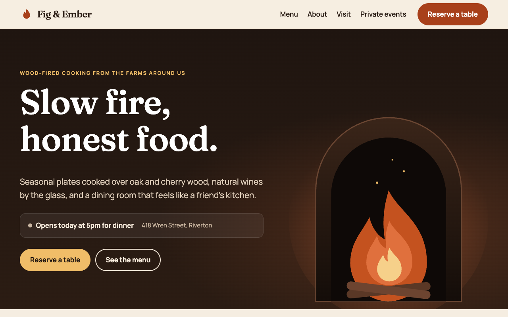

# Fig & Ember: restaurant website template

A warm, mobile-first restaurant website template with a live "open today" status, a menu built from one data file, and a private events inquiry form. Built with Astro as a fully static site.



[](https://console.cloudzyro.com/new?repo=https://github.com/Cloudzyro/template-restaurant)

## What's included

- Home page hero with today's hours worked out in your restaurant's time zone ("Open now until 10pm", "Opens tomorrow at 5pm") and a reserve button that goes to any booking link you choose
- Menu page built from a data file: sections, dishes, prices and dietary tags (vegetarian, vegan, gluten free, dairy free, nuts) with a key
- About page for the chef and the story of the place
- Gallery of illustrated placeholders, ready to swap for your own photos
- Visit page with address, a full hours table (today highlighted), directions tips and a maps link
- Private events page with an inquiry form that works without a server
- Restaurant structured data, Open Graph tags, sitemap, robots.txt and favicon
- Responsive down to 360px, keyboard friendly, visible focus styles and reduced motion respected
- No tracking and no third-party scripts

## Run it locally

You need Node 22.23 or newer and pnpm.

```bash
pnpm install
pnpm dev       # http://localhost:4321
pnpm build     # static site in dist/
pnpm preview   # serve the build
```

## Make it yours

- **Content:** everything lives in `src/data/site.ts`: name, address, phone, time zone, reservation link, opening hours, menu, chef story, gallery captions and the events text.
- **Reservations:** set `reservationUrl` in `src/data/site.ts` to your booking page (OpenTable, Resy, Tock, your own form or a `tel:` link).
- **Hours:** each day has a list of services with 24-hour times, so brunch and dinner on the same day work. Set `timeZone` to where the restaurant is.
- **Inquiry form:** set `PUBLIC_FORM_ENDPOINT` to a form service address (Formspree, Basin, a Supabase function or similar). The form posts its fields there. With no endpoint set, the form shows a short note and opens the visitor's email app addressed to your `email`.
- **Site address:** set `SITE_URL` (for example `https://www.yourrestaurant.com`) so the sitemap, canonical links and social previews use it.
- **Colors and fonts:** the variables at the top of `src/styles/global.css`. Fonts are Fraunces and Manrope, self-hosted through Fontsource; swap the packages and the `--font-*` variables to change them.
- **Photos:** the gallery and chef portrait are SVG illustrations in `src/components/Art.astro` and the page files. Put your photos in `src/assets/` and use Astro's `<Image>` component in their place.
- **Social preview image:** replace `public/og.png` (1200 x 630).

Copy `.env.example` to `.env` to set the variables locally. On Cloudzyro, add them in your site's environment settings.

## Deploy

Click the button above to make your own copy and put it online, or push your copy to GitHub and connect the repository in the Cloudzyro console. It builds with `pnpm build` and serves the static `dist/` folder.

## Stack

- [Astro](https://astro.build) 7, static output
- `@astrojs/sitemap`
- Fraunces and Manrope via Fontsource
- Plain CSS, a few lines of TypeScript for the menu toggle, today's hours and the form

## License

MIT, see [LICENSE](./LICENSE).
